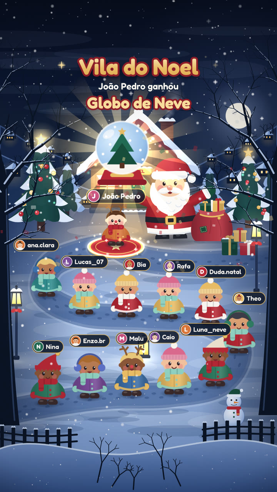

# Vila do Noel Live

> **Para usar na live, siga o passo a passo [docs/COMO-RODAR-NA-LIVE.md](docs/COMO-RODAR-NA-LIVE.md).**
> Ele é a versão mais atual de tudo o que está aqui: instalar, abrir pelo `iniciar.bat`,
> ligar a leitura da live e levar a tela para o TikTok LIVE Studio ou para o OBS.

Jogo interativo natalino para lives verticais (9:16). Quem participa da live vira um
gnomo com nome e foto, entra na fila da sala do Papai Noel, caminha até ele e recebe um
presente com animação e fala personalizada.

Os presentes são só animações decorativas: não têm valor, não são sorteio e não podem
ser resgatados.

A tela da live é a **Vila do Noel 3D** (a sala com o Noel na poltrona). A versão 2D
antiga continua guardada como versão clássica, em `/classico.html`.

O jogo roda inteiro no seu computador e **lê a live do TikTok pelo @ da sua conta**, sem
pedir senha: no painel, escreva o @ e clique em **Conectar**. Essa leitura usa uma
biblioteca gratuita e **não oficial** (`tiktok-live-connector`); os riscos estão em
[docs/INTEGRACAO.md](docs/INTEGRACAO.md), na parte "Riscos". Quem está na live entra na
fila mandando um presente ou, de graça, digitando `!presente`, `!noel` ou `!fila` no chat.



*(Imagem da versão clássica 2D.)*

---

## 1. O que você precisa

- Windows 10 ou 11.
- [Node.js](https://nodejs.org), versão LTS (**22 ou mais nova**; a leitura da live não
  funciona com versões mais velhas). É gratuito.
- Chrome ou Edge.
- Para transmitir: OBS Studio ou TikTok LIVE Studio.

Não há nenhum serviço pago nem conta para criar.

## 2. Instalação no Windows, passo a passo

1. Instale o Node.js: abra <https://nodejs.org>, baixe o instalador **LTS** e instale
   aceitando o que ele sugerir.
2. Extraia o `.zip` do projeto: clique nele com o botão direito, escolha **Extrair
   tudo** e use uma pasta simples fora do OneDrive, por exemplo `C:\VilaDoNoel`. Se dentro
   da pasta extraída houver só outra pasta com o mesmo nome, entre nela. (Detalhes, como
   desbloquear o zip antes, em [docs/COMO-RODAR-NA-LIVE.md](docs/COMO-RODAR-NA-LIVE.md).)
3. Abra a pasta e dê dois cliques em **`iniciar.bat`**.
   - Na primeira vez ele instala os componentes do jogo. Leva alguns minutos e precisa
     de internet. Não dê dois cliques de novo enquanto isso.
   - Se o Windows mostrar um aviso de segurança, clique em **Mais informações** e
     depois em **Executar assim mesmo** (ou em **Executar**). O `iniciar.bat` confere o
     Node.js e a porta e roda os comandos `npm install` e `npm start`; você pode abri-lo
     no Bloco de Notas para conferir.
4. O **painel de controle** abre sozinho no navegador. Nele, clique em
   **Abrir a tela do jogo**: a sala 3D aparece em uma janela vertical ao lado do painel.
5. Deixe a janela preta do `iniciar.bat` aberta enquanto usar o jogo. Para encerrar,
   feche essa janela.

Prefere digitar os comandos? Abra o Prompt de Comando dentro da pasta do jogo e rode:

```
npm install
npm start
```

Depois abra `http://localhost:3000/painel.html` no navegador.

## 3. Primeiro teste

Com o painel e a tela do jogo abertos lado a lado:

1. Clique em **🌹 Simular rosa**.
2. Um gnomo entra na fila da sala.
3. Quando chega a vez dele, ele anda até o Papai Noel, sentado na poltrona.
4. O Noel cumprimenta pelo nome e diz "Vamos ver qual é o seu presente!".
5. O presente sai do saco, a caixa abre e o presente aparece com o nome da pessoa.
6. O gnomo comemora e vai embora, liberando a vez do próximo.

Clique várias vezes, ou use **+10 pessoas**, **+50 pessoas** e **+100 pessoas**, para ver
a fila cheia. Se o som não sair, clique uma vez dentro da tela do jogo (o navegador só
libera o áudio depois de um clique).

## 4. Endereços

| O que é | Endereço |
| --- | --- |
| Tela da live, jogo 3D (a que vai para a transmissão) | `http://localhost:3000/` |
| Tela da live para o OBS (sem avisos nem botões) | `http://localhost:3000/?obs` |
| Tela para a captura de janela do LIVE Studio | `http://localhost:3000/?obs&janela=1` (ou o `abrir-janela-da-live.bat`) |
| Painel de controle (só para você) | `http://localhost:3000/painel.html` |
| Versão clássica 2D | `http://localhost:3000/classico.html` |
| Entrada de eventos para integrações | `POST http://localhost:3000/api/evento` |

Opções que podem ir no fim do endereço da tela da live:

- `?obs` esconde o aviso "clique para ativar o som" e os botões. Use no OBS.
- `?limpar` começa com a fila vazia (por padrão a fila é guardada e volta se a
  página for recarregada).
- `?demo=1` faz visitantes fictícios entrarem sozinhos, para deixar a tela rodando em
  demonstração. Não use na live.
- `?depurar` mostra o FPS e o nível de qualidade (só para conferir).

Atalhos de teclado na tela da live: `R` cria um visitante de teste e `D` liga ou desliga
a demonstração automática.

## 5. Colocar na live

### OBS Studio (recomendado)

1. Em **Configurações → Vídeo**, use resolução de base e de saída **1080x1920**
   (ou saída 720x1280 em computadores mais fracos).
2. Em **Fontes**, clique em **+** e escolha **Navegador**.
3. Preencha: URL `http://localhost:3000/?obs`, largura `1080`, altura `1920`.
4. Marque **Controlar áudio via OBS** para o som do jogo aparecer no mixer.
5. Deixe desmarcado "Desligar a fonte quando não estiver visível".

O painel continua aberto no seu navegador normal, fora da transmissão.

**Sobre a voz do Noel no OBS:** a fonte de navegador do OBS normalmente não tem voz
sintetizada. A música e os efeitos funcionam, e o jogo percebe a falta da voz e segue
no ritmo normal, só com os balões de fala. O painel mostra essa situação no cartão
"Áudio". As saídas estão em [docs/AUDIO.md](docs/AUDIO.md): gravar as frases em arquivos
ou capturar uma janela do Chrome ou do Edge.

### TikTok LIVE Studio

O jeito mais seguro é a **captura de janela**: com o jogo aberto, feche a tela do jogo
aberta pelo painel e dê dois cliques em **`abrir-janela-da-live.bat`**. Ele abre uma janela
em pé, sem barra de endereço, com o som liberado e que continua animando mesmo com outra
janela na frente. No LIVE Studio, capture essa janela (a que mostra a sala do Noel, não a
janela preta). Não minimize a janela do jogo. O passo a passo completo, com o som e as
outras opções, está em [docs/COMO-RODAR-NA-LIVE.md](docs/COMO-RODAR-NA-LIVE.md), passo 6.

Ter acesso ao LIVE Studio ou à chave de transmissão para o OBS depende das regras do
TikTok para a sua conta.

### Rodar separado (VM + Cloudflare)

O modo acima roda tudo no seu computador. Também dá para separar: o **back-end**
(servidor) numa VM Linux na internet e o **front-end** (tela do jogo e painel) na
Cloudflare Pages. O computador da live só precisa do OBS e de um navegador.

```
 OBS (tela do jogo)  ──┐
                       ├──► Cloudflare Pages (front)      páginas do jogo, painel e config.json
 Navegador (painel)  ──┘          │  o config.json diz onde está o back-end
                                  ▼
                       wss:// (tempo real) e https:// (/api)
                                  │
                                  ▼
                       VM Linux: Caddy (HTTPS) ──► back-end (servidor.mjs)  ◄── live (POST /api/evento)
```

1. `npm run pacotes` gera as duas partes prontas em `pacotes/` (ou uma de cada vez:
   `npm run pacote:backend` e `npm run pacote:frontend`):
   - `pacotes/backend/` e `pacotes/vila-do-noel-backend.zip`: o servidor para a VM.
   - `pacotes/frontend/` e `pacotes/vila-do-noel-frontend.zip`: as páginas para a Cloudflare.
2. Siga o passo a passo do back-end: [deploy/backend/LEIA-ME.md](deploy/backend/LEIA-ME.md)
   (o mesmo arquivo vai dentro do pacote). Ele cobre criar a VM, instalar o Node 22 (LTS),
   configurar o `.env` (senha do painel e endereços permitidos), deixar rodando com o
   systemd e ativar o HTTPS com o Caddy.
3. Depois o do front-end: [deploy/frontend/LEIA-ME.md](deploy/frontend/LEIA-ME.md). Ele cobre
   editar o `config.json` com o endereço do back-end, publicar na Cloudflare Pages
   arrastando a pasta, abrir o painel com a senha e copiar dele o endereço do OBS
   (`https://SEU-PROJETO.pages.dev/?obs&tela=…`).

Nesse modo o painel pede a senha (`TOKEN_ADMIN`) na primeira vez; a tela do jogo só recebe
dados e conecta com a chave da tela que vai no endereço do OBS (o painel mostra o endereço
pronto); e o servidor só aceita as páginas listadas em `ORIGENS_PERMITIDAS`. No modo local
nada disso precisa ser configurado.

## 6. Painel de controle

| Cartão | Para que serve |
| --- | --- |
| Live do TikTok | Escrever o @ da conta e conectar a leitura da live. Mostra a situação (Esperando a live começar, Ao vivo, Reconectando...), o título da live, os espectadores e os contadores. **Conferir agora** tenta conectar na hora. |
| Efeitos da sala | Tocar na hora os quatro efeitos (árvore, lareira, trenó, noite mágica) e ajustar qual presente da live dispara qual efeito (regra provisória). |
| Simulador de eventos | Criar participantes de teste: rosa, comando `!presente`, outro presente, novo seguidor, grupos de 10, 50 e 100, evento duplicado e a mesma pessoa de novo. |
| Fila agora | Ver quantos esperam, quem está com o Noel e quantos já foram atendidos. Pausar, pular a pessoa atual e limpar a fila. |
| Ritmo | Velocidade da entrega, aceleração automática quando a fila cresce, quantos personagens aparecem ao mesmo tempo, tamanho máximo da fila e espera para a mesma pessoa participar de novo. |
| Áudio | Volume geral, música, efeitos e voz, cada um separado. Ligar e desligar a voz e a fala do nome. Testar a voz. |
| Como as pessoas entram | Se presente coloca na fila, se seguir coloca na fila, quais comandos gratuitos do chat valem e o texto de instrução que aparece na tela. |
| Desempenho | Qualidade dos efeitos (automática por padrão), FPS na tela e recarregar a tela do jogo. |
| Registro | Histórico do que aconteceu: quem entrou, duplicados descartados, fila cheia, presentes entregues. |

As configurações ficam salvas em `data/configuracoes.json`.

## 7. Como o jogo se comporta

- **Ordem:** quem chega primeiro é atendido primeiro, por presente ou por comando.
- **Duplicados:** o mesmo evento chegando duas vezes conta uma só. A mesma pessoa não
  ocupa dois lugares na fila.
- **Fila cheia:** ao passar do limite (150 por padrão), a pessoa não entra, a tela mostra
  "A fila está cheia!" e o registro anota.
- **Muita gente:** só os primeiros da fila aparecem (11 por padrão). Os outros esperam
  fora da tela e entram conforme a fila anda. O contador mostra o total.
- **Ritmo:** na velocidade normal cada pessoa leva cerca de 10 segundos, e um pouco mais
  quando a voz do Noel está ligada, porque ele espera cada fala terminar. Com a fila
  grande o jogo acelera sozinho, até o dobro.
- **Desempenho:** o jogo mede o FPS e reduz neve e partículas quando o computador não
  dá conta, voltando ao normal depois.
- **Fila vazia:** o Noel solta uma frase de convite de tempos em tempos.

## 8. Comandos

| Comando | O que faz |
| --- | --- |
| `npm start` | Prepara o jogo e inicia o servidor em `http://localhost:3000`. É o que o `iniciar.bat` usa. |
| `npm run dev` | Modo de desenvolvimento em `http://localhost:5173`, que atualiza a tela ao salvar o código. |
| `npm test` | Roda os testes automáticos da fila, dos eventos, das regras, da senha do painel, do endereço do back-end, da leitura da live (com um conector falso) e do jogo 3D. |
| `npm run typecheck` | Confere os tipos do TypeScript. |
| `npm run demo` | Gera em `dist-demo/` uma demonstração que roda sozinha, sem servidor, para hospedar como página estática e mostrar o visual. |
| `npm run pacotes` | Gera em `pacotes/` o back-end para a VM e o front-end para a Cloudflare (veja "Rodar separado"). |

Para usar outra porta: `set PORT=3100 && npm start`.

## 9. Estrutura do projeto

```
vila-do-noel/
├── iniciar.bat            atalho para instalar e iniciar no Windows
├── parar.bat              encerra o jogo
├── abrir-janela-da-live.bat   janela em pé para a captura do TikTok LIVE Studio
├── abrir-janela-da-live-grande.bat   o mesmo, em 1080x1920 (telas grandes)
├── index.html             tela da live: o jogo 3D (src/jogo3d/)
├── classico.html          versão clássica 2D
├── painel.html            painel de controle
├── demo.html              demonstração 2D que roda sem servidor
├── shared/                tipos usados pelo servidor e pelas telas
├── server/                servidor (Node.js + WebSocket), no PC ou na VM
│   ├── index.ts           inicia o servidor com a configuração do ambiente (.env)
│   ├── app.ts             rotas, WebSocket, senha do painel e entrada de eventos
│   ├── config.ts          configurações (PORT, HOST, TOKEN_ADMIN, ORIGENS_PERMITIDAS…)
│   ├── security.ts        origens permitidas, senha e limites
│   ├── EventHub.ts        recebe eventos, descarta duplicados, aplica regras
│   ├── rules.ts           quem entra na fila
│   ├── dedup.ts           eventos duplicados
│   ├── settingsStore.ts   configurações salvas
│   ├── avatars.ts         fotos de perfil
│   └── integrations/      fontes de eventos: simulador e a leitura da live do TikTok (TikTokSource.ts)
├── src/                   telas (TypeScript; jogo 3D com Three.js, versão clássica com Phaser)
│   ├── jogo3d/            jogo 3D (a tela da live)
│   ├── world/             arte 3D: sala, Noel, gnomos, presentes
│   ├── config.ts          cores, posições, caminho da fila e tempos
│   ├── render/            cenário e toda a arte, desenhada por código
│   ├── queue/             fila (lógica e movimento na tela)
│   ├── characters/        personagens e etiquetas de nome
│   ├── santa/             Papai Noel e biblioteca de frases
│   ├── gifts/             catálogo de presentes
│   ├── animations/        sequência da entrega
│   ├── audio/             voz, efeitos, música e volumes
│   ├── effects/           neve e controle de desempenho
│   ├── events/            comunicação com o servidor
│   ├── ui/                título, contador, avisos e balão de fala
│   └── admin/             painel de controle
├── public/audio/          música e frases gravadas, se você quiser usar
├── tests/                 testes automáticos
├── deploy/                pacotes para rodar separado: modelos da VM e da Cloudflare
└── docs/                  áudio, integração, direção criativa e pendências
```

## 10. Onde ajustar sem mexer na lógica

A tabela abaixo vale para a lógica comum e para a versão clássica 2D. Os ajustes do jogo 3D
(câmera, tempos da entrega, sala, Noel, gnomos e presentes) estão em `docs/3D/`.

| Quero mudar | Arquivo |
| --- | --- |
| Cores, posição da casa, do Noel e da fila, tempos | `src/config.ts` |
| Frases do Papai Noel e reações dos visitantes | `src/santa/phrases.ts` |
| Lista de presentes | `src/gifts/giftCatalog.ts` e o desenho em `src/render/textures/gifts.ts` |
| Valores iniciais do painel | `shared/types.ts`, em `DEFAULT_SETTINGS` |
| Endereço do back-end usado pelas páginas (modo separado) | `config.json` publicado com o front (modelo em `deploy/frontend/config.json`) |
| Desenho do cenário | `src/render/textures/scenery.ts` e `src/render/Scenery.ts` |
| Visual dos visitantes e do Noel | `src/render/textures/visitors.ts` e `santa.ts` |

## 11. Problemas comuns

- **"O Node.js não foi encontrado" ou "antigo demais":** instale a versão LTS (22 ou mais
  nova) pelo site e abra o `iniciar.bat` de novo.
- **"A porta 3000 já está em uso":** o jogo já está aberto em outra janela. Feche a
  outra, ou use outra porta com `set PORT=3100 && npm start`.
- **A tela abre, mas nada acontece ao simular:** confira no topo do painel se aparece
  "Tela do jogo: aberta". Se a tela estiver em uma aba escondida ou minimizada, o
  navegador pausa as animações.
- **Sem som:** clique uma vez dentro da tela do jogo. No OBS, marque "Controlar áudio
  via OBS".
- **O Noel não fala:** veja o aviso no cartão "Áudio" do painel e o arquivo
  [docs/AUDIO.md](docs/AUDIO.md).
- **Animação travando:** no painel, em "Desempenho", escolha qualidade Média ou Baixa e
  diminua "Personagens visíveis na fila". No OBS, ligue a aceleração por hardware da
  fonte de navegador em Configurações → Avançado.
- **Personagens em dobro:** há duas telas do jogo abertas ao mesmo tempo. Deixe só uma.
- **A instalação falhou:** confira a internet, apague a pasta `node_modules` e abra o
  `iniciar.bat` de novo.

## 12. Outros documentos

- [docs/COMO-RODAR-NA-LIVE.md](docs/COMO-RODAR-NA-LIVE.md): passo a passo para a live no seu PC.
- [docs/3D/](docs/3D/LEIA-PRIMEIRO.md): documentação do jogo 3D (para quem programa).
- [docs/PENDENCIAS.md](docs/PENDENCIAS.md): o que está pronto, limitações e próximos passos.
- [docs/DIRECAO-CRIATIVA.md](docs/DIRECAO-CRIATIVA.md): escolhas provisórias que precisam
  do aval da direção criativa.
- [docs/AUDIO.md](docs/AUDIO.md): voz, música e efeitos.
- [docs/INTEGRACAO.md](docs/INTEGRACAO.md): como os eventos entram, a leitura da live do
  TikTok e os riscos dela.

## Recursos usados

A arte é original. O jogo 3D usa só modelos e texturas do Poly Haven (licença CC0), com os
créditos em `public/assets/CREDITOS.md`; a versão clássica 2D é desenhada por código. A
música e os efeitos sonoros são sintetizados pelo próprio jogo. Bibliotecas, todas
gratuitas e de código aberto: Three.js, Phaser, Vite, TypeScript, ws, tsx, a fonte Fredoka
(licença SIL Open Font) e o `tiktok-live-connector` (licença AGPL-3.0; usar no seu
computador ou na sua VM não obriga a nada, mas quem repassar o servidor para outras
pessoas precisa entregar o código junto, como explica `docs/INTEGRACAO.md`).
