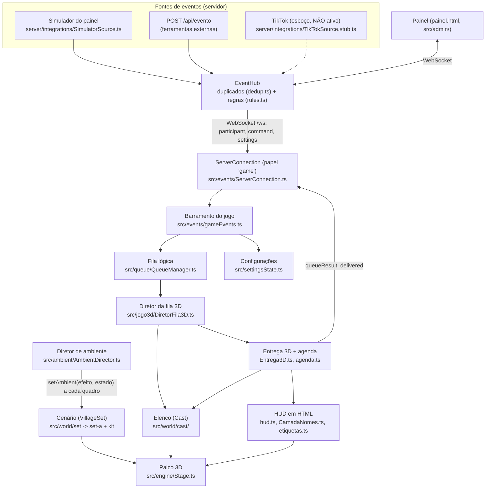

# Arquitetura

Como o jogo é organizado por dentro. A ideia central: **a camada de eventos e a camada visual são
separadas**. O servidor e a fila não sabem desenhar; o cenário e os personagens não sabem o que é uma
fila nem o TikTok. Eles se encontram em contratos pequenos (`src/world/contracts.ts`), e por isso a arte
pode ser trocada (2D por 3D, um Noel por um GLB) sem mexer na lógica.

## Visão geral

Se o diagrama não aparecer (ele usa Mermaid, que o GitHub mostra), a ordem é: fonte de eventos →
servidor (`EventHub`) → WebSocket → `ServerConnection` → barramento → fila → diretor da fila 3D →
entrega → elenco, cenário e interface → palco 3D.

## As camadas, uma por uma

### 1. Eventos e servidor (`server/`, `shared/`)

- `server/index.ts` liga o servidor com a configuração do ambiente (`server/config.ts`, `.env`). Sem nada
  configurado, roda em `127.0.0.1:3000`, sem senha, servindo as páginas.
- `server/app.ts`: rotas HTTP, WebSocket (`/ws`), senha do painel e entrada de eventos
  (`POST /api/evento`).
- `server/EventHub.ts` recebe cada evento da live (`shared/types.ts`, `LiveEvent`: `gift`, `chat`,
  `follow`, `like`, `share`, `join`), descarta duplicados (`dedup.ts`), aplica as regras de quem entra
  na fila (`rules.ts`: presente, comandos gratuitos `!presente`, `!noel`, `!fila`) e manda um
  `participant` para a tela do jogo.
- `server/security.ts`: origens permitidas, senha (`TOKEN_ADMIN`), limites de conexão e de tamanho.
- `server/env.ts` lê o arquivo `.env` sem pacote extra; `server/static.ts` entrega os arquivos das páginas
  quando o servidor também serve o front; `server/avatars.ts` repassa as fotos de perfil dos participantes,
  só de hosts permitidos (`AVATAR_HOSTS_PERMITIDOS`) e só imagens comuns (SVG fica de fora). Todas as
  configurações, com explicação, estão em `deploy/backend/.env.example`.
- `server/integrations/LiveSource.ts`: o contrato de uma fonte de eventos (`name`, `start(emit)`,
  `stop()`). O simulador é a única fonte ligada. O TikTok é só um esboço, de propósito.
- `server/settingsStore.ts` guarda as configurações do painel em `data/configuracoes.json`.

Essa camada é a mesma para o 2D e o 3D. Detalhes do formato dos eventos: `docs/INTEGRACAO.md`.

### 2. Fila (`src/queue/QueueManager.ts`)

Lógica pura, sem desenho, compartilhada pelo 2D e pelo 3D: ordem de chegada, a mesma pessoa não ocupa
dois lugares, limite da fila (150 por padrão), espera para a mesma pessoa voltar. Tem testes em
`tests/fila.test.ts`.

### 3. Diretor de ambiente (`src/ambient/AmbientDirector.ts`, `shared/ambient.ts`)

A agenda dos quatro efeitos ambientes. É lógica pura e não conhece a fila do Noel. Recebe pedidos
(`request`), decide o que toca, o que espera e o que é descartado, e a cada quadro informa o estado de cada
efeito: `intensity` (0 a 1, já com entrada e saída suaves) e `progress` (0 a 1 ao longo da duração).

| Efeito | Nome no painel | Duração | Prioridade | Descanso mínimo |
| --- | --- | --- | --- | --- |
| `TREE_SPARKLE` | Árvore cintilante | 6 s | 1 | 4 s |
| `FIREPLACE_MAGIC` | Lareira mágica | 8 s | 2 | 6 s |
| `SLEIGH_PASS` | Trenó no céu | 9 s | 3 | 20 s |
| `MAGICAL_NIGHT` | Noite mágica (aurora) | 16 s | 4 | 30 s |

Proteções contra excesso (`DEFAULT_AMBIENT`): no máximo 2 efeitos ao mesmo tempo, no máximo 6 pedidos
esperando, pedido repetido do mesmo efeito só prolonga (até o dobro da duração), e um efeito mais
importante faz o menos importante terminar mais cedo.

Hoje os efeitos são pedidos pelos botões de `demo-sala.html` e de `jogo3d.html?demo=1`, e pelo endereço
(`?efeito=`). O jogo 3D já aceita uma mensagem `ambient` do servidor, mas **o servidor e o painel ainda
não a enviam** (pendência em `PROXIMOS-PASSOS.md`).

### 4. Palco 3D (`src/engine/`)

- `Stage.ts`: o renderizador WebGL, a câmera, as sombras (`PCFShadowMap`), o pós-processamento (oclusão de
  ambiente GTAO só no nível alto, brilho `UnrealBloomPass`, um acabamento com vinheta, separação quente e
  frio e granulado), o encaixe 9:16 na janela e uma camada HTML por cima do canvas (`stage.overlay`) para
  título, nomes e balões. Não conhece o jogo nem o cenário: recebe um `Look` e desenha.
- Níveis de qualidade `alta`, `media`, `baixa`: resolução 1, 0,8 e 0,64. A oclusão (GTAO) e o MSAA só
  existem em `alta`; em `baixa` saem também o brilho e o acabamento. `src/effects/PerformanceMonitor.ts`
  troca o nível sozinho pelo FPS.
- `assets.ts`: `loadModel` (GLB, com cache e cópias que compartilham geometria e material), `loadPbr`
  (conjunto de texturas PBR), `loadTexture`, `loadEnvironment`, `assetUrl`.
- `Path3.ts`: caminho no chão percorrido por distância, suavizado (usado pela fila e pela saída).

### 5. Cenário (`src/world/set/`, `set-a/`, `kit/`)

O cenário cumpre o contrato `VillageSet`: `root`, `look`, `anchors`, `environment`, `update(dt, t)`,
`setQuality`, `setDeliveryActive`, `setAmbient`, `dispose`. O jogo usa `src/world/set/index.ts`, que hoje
reexporta a composição A (`src/world/set-a/`). Detalhes em [CENARIO.md](CENARIO.md).

### 6. Elenco (`src/world/cast/`)

O elenco cumpre o contrato `Cast`: `createVisitor(seed)`, `createSanta()`, `createGift(id)`,
`createGiftBox()`, `setQuality`. `src/world/cast/index.ts` junta três partes que podem ser trocadas
sozinhas: `visitors.ts` (gnomos), `santa.ts` (o Noel) e `gifts.ts` (presentes, em construção). Detalhes em
[PERSONAGENS.md](PERSONAGENS.md).

### 7. Interface da live (HUD) (`src/jogo3d/hud.ts`, `CamadaNomes.ts`, `etiquetas.ts`)

Em construção. Tudo é HTML por cima do canvas, em pixels de projeto 1080x1920: título, instrução,
contador, balão de fala do Noel, faixa "Fulano ganhou ...", aviso de fila cheia, selo "+N" e etiquetas de
nome com foto. Por quadro só mudam `transform` e `opacity`. As regras das etiquetas (`etiquetas.ts`):
só quem está sendo atendido e os primeiros 6 da fila mostram o nome; nenhuma etiqueta cobre o rosto do
Noel, o saco, a entrega, o balão ou o presente; quem não cabe vira o "+N".

Zonas da tela da live (TikTok desenha por cima):

| Faixa vertical (px) | Uso |
| --- | --- |
| 0 a 190 | barra do TikTok: nada importante |
| 190 a 420 | título do jogo |
| 430 a 1480 (x de 60 a 1020) | área de jogo: Noel, entrega e fila |
| 1480 a 1920 | chat e botões do TikTok cobrem: só cenário |

## Os contratos (`src/world/contracts.ts`)

É a fonte da verdade entre o jogo e a arte. Resumo:

- `Look`: fundo, neblina, tone mapping, exposição, força dos reflexos, oclusão, brilho, acabamento e
  câmera (posição, alvo, FOV, balanço).
- `VillageAnchors`: `santa` (lugar do Noel), `delivery` (onde o visitante para), `reveal` (onde o presente
  aparece grande), `queuePath` (caminho da fila, que termina em `delivery`), `exitPath`, `queueSpacing`,
  `frontGap`.
- `VillageSet`: o cenário (veja acima). `setAmbient` recebe o estado já calculado pela agenda; o cenário
  só desenha, sem relógio próprio.
- `VisitorPose` (`walk`, `phase`, `jump`, `hold`, `joy`, `lookUp`) e `VisitorRig` (`root`, `pose`,
  `labelAnchor`, `giftAnchor`, `height`, `update`, `dispose`).
- `SantaPose` (`wave`, `talk`, `rummage`, `present`, `give`, `cheer`) e `SantaRig` (`root`, `pose`,
  `sackMouth`, `bubbleAnchor`, `height`, `update`, `dispose`).
- `GiftBox` (`root`, `lid`, `body`) e `Cast`.

O jogo escreve números nas poses a cada quadro e chama `update(dt, t)`; o boneco mistura as poses. Mudar
um contrato afeta o 2D, o 3D, o laboratório e o cenário provisório (`src/world/provisorio/`, que é o
exemplo mínimo de cada contrato).

## Como o 3D reaproveita a lógica do 2D

O jogo 3D (`src/jogo3d/main.ts`, em construção) **não reescreve** a lógica. Ele usa as mesmas peças do 2D:

| Peça do 2D reaproveitada | Arquivo |
| --- | --- |
| Fila lógica | `src/queue/QueueManager.ts` |
| Barramento de eventos | `src/events/gameEvents.ts` |
| Conexão com o servidor no papel `game` | `src/events/ServerConnection.ts`, `src/events/backend.ts` |
| Configurações do painel | `src/settingsState.ts` |
| Catálogo dos 12 presentes | `src/gifts/giftCatalog.ts` |
| Frases do Noel (incluindo a obrigatória) | `src/santa/phrases.ts` |
| Voz, música e efeitos sonoros | `src/audio/AudioManager.ts` |
| Qualidade automática pelo FPS | `src/effects/PerformanceMonitor.ts` |
| Agenda dos efeitos ambientes | `src/ambient/AmbientDirector.ts` |

O que é próprio do 3D (pasta `src/jogo3d/`, em construção):

| Arquivo | O que faz | Equivalente no 2D |
| --- | --- | --- |
| `DiretorFila3D.ts` | Liga a fila lógica aos gnomos na sala: monta cada gnomo com antecedência, faz entrar em ordem, andar até o lugar, ir à entrega e sair. | `src/queue/QueueDirector.ts` |
| `caminhante.ts` | Um gnomo andando por um caminho, com aceleração e sem patinar. | parte de `src/characters/` |
| `elenco.ts` | Plano de quem montar e quem entra em cena (no máximo um gnomo novo por quadro). | |
| `agenda.ts` | Roteiro puro de cada atendimento: chegada, saudação, fala obrigatória, saco, caixa, suspense, abertura, revelação, entrega e festa. | `src/animations/DeliverySequence.ts` |
| `Entrega3D.ts` | Executa a agenda com o Noel, o visitante, a caixa e o presente; espera a voz terminar; pode ser interrompida por "Pular". | `src/animations/DeliverySequence.ts` |
| `hud.ts`, `CamadaNomes.ts`, `etiquetas.ts` | Interface da live e etiquetas de nome. | `src/ui/`, `src/characters/NameLabel.ts` |
| `simulador.ts`, `sorteio.ts` | Visitantes fictícios e gerador com semente (demonstração e captura). | `src/events/localSimulator.ts` |
| `descarte.ts` | Libera presentes e caixas que saem de cena. | |
| `config.ts` | Números do jogo 3D (velocidade de caminhada, fila, escala do presente). | `src/config.ts` |

O jogo 3D recebe do servidor `participant`, `command` (`skip`, `clear`, `test_voice`, `reload`) e
`settings`, e devolve `queueResult` e `delivered`, exatamente como o 2D. Por isso o painel atual serve aos
dois.

Parâmetros do endereço de `jogo3d.html` (do cabeçalho de `src/jogo3d/main.ts`): `?obs`, `?demo=1`,
`?manual=1`, `?q=alta|media|baixa`, `?fila=N`, `?auto=1`, `?visiveis=N`, `?semente=texto`,
`?velocidade=1.5`, `?efeito=SLEIGH_PASS`, `?pr=0.5`, `?limpar`. Teclas: `R` cria um visitante de teste, `D`
liga ou desliga a demonstração.
